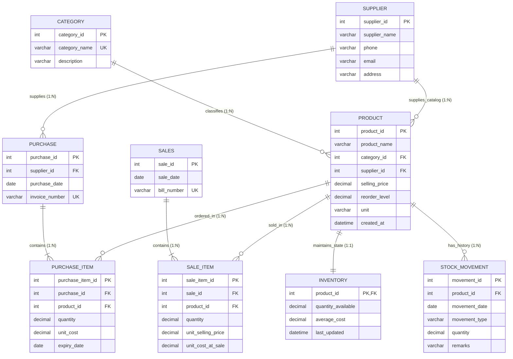

# PHASE 2: ER DIAGRAM, RELATIONAL SCHEMA & NORMALIZATION

**Project Title:** Grocery Store Inventory Management System  
**Database Name:** `grocery_inventory`  
**Standard Compliance:** 1NF, 2NF, 3NF, BCNF  

---

## 1. ENTITY-RELATIONSHIP (ER) DIAGRAM

Below is the complete Crow's Foot ER Diagram illustrating all nine entities, attributes, primary keys (`PK`), foreign keys (`FK`), and their exact cardinalities.

---

## 2. RELATIONAL SCHEMA NOTATION

The formal relational schema is expressed below. Primary keys are **underlined**, and foreign keys are denoted with an asterisk (`*`):

1. **`Category`** (<u>category_id</u>, category_name, description)
2. **`Product`** (<u>product_id</u>, product_name, category_id*, selling_price, reorder_level, unit, created_at)
   - Foreign Key: `category_id` $\to$ `Category(category_id)`
3. **`Supplier`** (<u>supplier_id</u>, supplier_name, phone, email, address)
4. **`Purchase`** (<u>purchase_id</u>, supplier_id*, purchase_date, invoice_number)
   - Foreign Key: `supplier_id` $\to$ `Supplier(supplier_id)`
5. **`Purchase_Item`** (<u>purchase_item_id</u>, purchase_id*, product_id*, quantity, unit_cost, expiry_date)
   - Foreign Key: `purchase_id` $\to$ `Purchase(purchase_id)`
   - Foreign Key: `product_id` $\to$ `Product(product_id)`
6. **`Sales`** (<u>sale_id</u>, sale_date, bill_number)
7. **`Sale_Item`** (<u>sale_item_id</u>, sale_id*, product_id*, quantity, unit_selling_price, unit_cost_at_sale)
   - Foreign Key: `sale_id` $\to$ `Sales(sale_id)`
   - Foreign Key: `product_id` $\to$ `Product(product_id)`
8. **`Inventory`** (<u>product_id*</u>, quantity_available, average_cost, last_updated)
   - Foreign Key & Primary Key: `product_id` $\to$ `Product(product_id)` (Enforces 1:1 relationship)
9. **`Stock_Movement`** (<u>movement_id</u>, product_id*, movement_date, movement_type, quantity, remarks)
   - Foreign Key: `product_id` $\to$ `Product(product_id)`

---

## 3. INTEGRITY CONSTRAINTS & REFERENTIAL ACTION MATRIX

To protect historical transaction records and prevent data anomalies, strict referential integrity rules are enforced:

| Foreign Key Constraint | Referencing Table | Referenced Table | `ON UPDATE` | `ON DELETE` | Academic Justification |
| :--- | :--- | :--- | :--- | :--- | :--- |
| `fk_prod_cat` | `Product` | `Category` | `CASCADE` | `RESTRICT` | Cannot delete a category if products belong to it; prevents orphaned products. |
| `fk_pur_supp` | `Purchase` | `Supplier` | `CASCADE` | `RESTRICT` | Cannot delete a supplier who has past purchase invoices; maintains financial audit trail. |
| `fk_puritem_pur` | `Purchase_Item` | `Purchase` | `CASCADE` | `CASCADE` | If a draft purchase order is removed, its items are cleanly removed. |
| `fk_puritem_prod` | `Purchase_Item` | `Product` | `CASCADE` | `RESTRICT` | Cannot delete a product that has been purchased; prevents corrupting historical inventory records. |
| `fk_saleitem_sale`| `Sale_Item` | `Sales` | `CASCADE` | `CASCADE` | Items belong to a sale transaction; deletion cascades cleanly. |
| `fk_saleitem_prod`| `Sale_Item` | `Product` | `CASCADE` | `RESTRICT` | Cannot delete a product that has historical sales records; guarantees revenue reports remain intact. |
| `fk_inv_prod` | `Inventory` | `Product` | `CASCADE` | `CASCADE` | 1:1 relationship with product master record. |
| `fk_sm_prod` | `Stock_Movement` | `Product` | `CASCADE` | `RESTRICT` | Stock movement history is an immutable audit log and must never be deleted. |

---

## 4. NORMALIZATION ANALYSIS (UNF $\to$ 1NF $\to$ 2NF $\to$ 3NF $\to$ BCNF)

### Step 1: Unnormalized Form (UNF)
Consider how an unnormalized single grocery store spreadsheet would look:
`Store_Receipt (invoice_no, date, supplier_name, supplier_phone, supplier_addr, item_id, item_name, category, price, cost, qty, total_stock, movement_type, remarks)`

**Anomalies in UNF:**
- **Insertion Anomaly:** Cannot record a new supplier without buying a product; cannot create a new category without adding a product.
- **Deletion Anomaly:** If we delete the last purchase of a product, we accidentally delete the supplier's contact details and product catalog information.
- **Update Anomaly:** If a supplier's phone number changes, we must update hundreds of historical rows; missing even one creates data inconsistency.

---

### Step 2: First Normal Form (1NF)
**Rule:** A relation is in 1NF if and only if all attribute values are atomic (no repeating groups, multi-valued attributes, or nested tables) and every row is uniquely identifiable.

- In our grocery system:
  - An invoice contains multiple items. Instead of storing `items = "Rice:5kg, Sugar:2kg"`, each item is placed into its own atomic row.
  - Repeating groups are eliminated by splitting transactions into `Purchase` and `Purchase_Item`, and `Sales` and `Sale_Item`.
  - Every column holds single, indivisible values: `quantity` is a single decimal value, `unit` is a single string.
- **Result:** The database satisfies **1NF**.

---

### Step 3: Second Normal Form (2NF)
**Rule:** A relation is in 2NF if it is in 1NF and every non-prime attribute is fully functionally dependent on the primary key (no partial dependencies on a composite candidate key).

- Examine `Purchase_Item`:
  - If we had used a composite key `(purchase_id, product_id)`:
    - `quantity` depends on `(purchase_id, product_id)`. (Full dependency)
    - `unit_cost` depends on `(purchase_id, product_id)`. (Full dependency)
    - If `product_name` or `unit` were in `Purchase_Item`, they would depend ONLY on `product_id` (a subset of the composite key). This would be a **partial dependency**.
  - **Resolution:** `product_name`, `unit`, and `reorder_level` are moved to the `Product` entity. `Purchase_Item` retains only attributes that depend on the specific purchase line.
  - Furthermore, using a surrogate primary key `purchase_item_id` ensures that all non-key attributes are fully dependent on the entire primary key.
- **Result:** The schema is completely free of partial dependencies and satisfies **2NF**.

---

### Step 4: Third Normal Form (3NF)
**Rule:** A relation is in 3NF if it is in 2NF and no non-prime attribute is transitively dependent on the primary key ($X \to Y$ and $Y \to Z$ where $Z$ is non-prime is disallowed).

- Examine `Product`:
  - `product_id` $\to$ `category_id`
  - If `category_name` and `category_description` were stored in `Product`:
    - `category_id` $\to$ `category_name`
    - Therefore, `product_id` $\to$ `category_name` would be a **transitive dependency**.
  - **Resolution:** Decomposed into `Category(category_id, category_name, description)` and `Product(product_id, category_id, ...)`.
- Examine `Purchase`:
  - `purchase_id` $\to$ `supplier_id`
  - If `supplier_name`, `phone`, `email` were in `Purchase`:
    - `supplier_id` $\to$ `supplier_name`
    - `purchase_id` $\to$ `supplier_name` would be a **transitive dependency**.
  - **Resolution:** Decomposed into `Supplier(supplier_id, supplier_name, ...)` and `Purchase(purchase_id, supplier_id, ...)`.
- Examine `Sale_Item`:
  - Stores `unit_cost_at_sale` and `unit_selling_price`. Notice these are NOT transitively dependent on `Product.selling_price` because they represent **point-in-time immutable transactional historical facts**, not the current catalog values.
- **Result:** All transitive dependencies are eliminated; the database satisfies **3NF**.

---

### Step 5: Boyce-Codd Normal Form (BCNF)
**Rule:** A relation is in BCNF if for every functional dependency $X \to Y$, the determinant $X$ is a superkey.

- In every relation in our design:
  - In `Category`: Candidate keys are `category_id` and `category_name`. Both are unique and determinants.
  - In `Product`: Candidate key is `product_id`.
  - In `Supplier`: Candidate key is `supplier_id`.
  - In `Purchase`: Candidate keys are `purchase_id` and `invoice_number`.
  - In `Purchase_Item`: Candidate key is `purchase_item_id`.
  - In `Sales`: Candidate keys are `sale_id` and `bill_number`.
  - In `Sale_Item`: Candidate key is `sale_item_id`.
  - In `Inventory`: Candidate key is `product_id`.
  - In `Stock_Movement`: Candidate key is `movement_id`.
- Every determinant is a candidate key / superkey.
- **Result:** The database satisfies **BCNF**.

---

## 5. COMPLETE DATA DICTIONARY

| Table Name | Column Name | Data Type | Nullable | Default | Constraints | Description |
| :--- | :--- | :--- | :--- | :--- | :--- | :--- |
| **Category** | `category_id` | INT | NO | AUTO_INCREMENT | PRIMARY KEY | Unique category identifier |
| | `category_name` | VARCHAR(60) | NO | NULL | UNIQUE | Category name (e.g. Grains, Dairy) |
| | `description` | VARCHAR(150)| YES| NULL | - | Brief category description |
| **Product** | `product_id` | INT | NO | AUTO_INCREMENT | PRIMARY KEY | Unique product identifier |
| | `product_name` | VARCHAR(100)| NO | NULL | - | Name of the grocery item |
| | `category_id` | INT | NO | NULL | FOREIGN KEY | References Category(category_id) |
| | `selling_price`| DECIMAL(10,2)| NO | 0.00 | CHECK >= 0 | Standard retail selling price per unit |
| | `reorder_level`| DECIMAL(10,3)| NO | 0.000| CHECK >= 0 | Minimum stock before low-stock alert |
| | `unit` | VARCHAR(20) | NO | NULL | - | kg, g, litre, ml, packet, piece, etc. |
| | `created_at` | DATETIME | NO | CURRENT_TIMESTAMP | - | Product registration timestamp |
| **Supplier** | `supplier_id` | INT | NO | AUTO_INCREMENT | PRIMARY KEY | Unique supplier identifier |
| | `supplier_name`| VARCHAR(100)| NO | NULL | - | Wholesale business name |
| | `phone` | VARCHAR(15) | YES| NULL | - | Supplier contact phone number |
| | `email` | VARCHAR(100)| YES| NULL | - | Supplier email address |
| | `address` | VARCHAR(200)| YES| NULL | - | Physical warehouse/office address |
| **Purchase** | `purchase_id` | INT | NO | AUTO_INCREMENT | PRIMARY KEY | Unique purchase order ID |
| | `supplier_id` | INT | NO | NULL | FOREIGN KEY | References Supplier(supplier_id) |
| | `purchase_date`| DATE | NO | NULL | - | Date wholesale stock was received |
| | `invoice_number`| VARCHAR(50)| NO | NULL | UNIQUE | Supplier's tax invoice/bill number |
| **Purchase_Item**| `purchase_item_id`| INT | NO | AUTO_INCREMENT | PRIMARY KEY | Unique purchase line item ID |
| | `purchase_id` | INT | NO | NULL | FOREIGN KEY | References Purchase(purchase_id) |
| | `product_id` | INT | NO | NULL | FOREIGN KEY | References Product(product_id) |
| | `quantity` | DECIMAL(10,3)| NO | NULL | CHECK > 0 | Fractional quantity received |
| | `unit_cost` | DECIMAL(10,2)| NO | NULL | CHECK >= 0 | Actual purchase price per unit |
| | `expiry_date` | DATE | YES| NULL | - | Optional grocery batch expiry date |
| **Sales** | `sale_id` | INT | NO | AUTO_INCREMENT | PRIMARY KEY | Unique sales bill ID |
| | `sale_date` | DATE | NO | NULL | - | Date counter sale was transacted |
| | `bill_number` | VARCHAR(50) | NO | NULL | UNIQUE | Counter invoice number (e.g. BILL-1001) |
| **Sale_Item** | `sale_item_id` | INT | NO | AUTO_INCREMENT | PRIMARY KEY | Unique sales line item ID |
| | `sale_id` | INT | NO | NULL | FOREIGN KEY | References Sales(sale_id) |
| | `product_id` | INT | NO | NULL | FOREIGN KEY | References Product(product_id) |
| | `quantity` | DECIMAL(10,3)| NO | NULL | CHECK > 0 | Fractional quantity sold |
| | `unit_selling_price`| DECIMAL(10,2)| NO | NULL | CHECK >= 0 | Selling price per unit at sale time |
| | `unit_cost_at_sale`| DECIMAL(10,2)| NO | NULL | CHECK >= 0 | Weighted average cost snapshot at sale |
| **Inventory** | `product_id` | INT | NO | NULL | PRIMARY KEY, FK| 1:1 Reference to Product(product_id) |
| | `quantity_available`| DECIMAL(10,3)| NO | 0.000 | CHECK >= 0 | Current in-stock quantity |
| | `average_cost` | DECIMAL(10,2)| NO | 0.00 | CHECK >= 0 | Current weighted average unit cost |
| | `last_updated` | DATETIME | NO | CURRENT_TIMESTAMP | ON UPDATE | Timestamp of latest stock update |
| **Stock_Movement**| `movement_id` | INT | NO | AUTO_INCREMENT | PRIMARY KEY | Unique movement log ID |
| | `product_id` | INT | NO | NULL | FOREIGN KEY | References Product(product_id) |
| | `movement_date`| DATE | NO | NULL | - | Date the stock event took place |
| | `movement_type`| VARCHAR(25) | NO | NULL | CHECK/ENUM | OPENING, PURCHASE, SALE, DAMAGE, etc. |
| | `quantity` | DECIMAL(10,3)| NO | NULL | CHECK > 0 | Absolute positive quantity moved |
| | `remarks` | VARCHAR(150)| YES| NULL | - | Reason or audit notes |

---

Phase 2 design is now complete and formalized. Proceed directly to **PHASE 3: Creating all nine database tables using phpMyAdmin-compatible SQL**.

