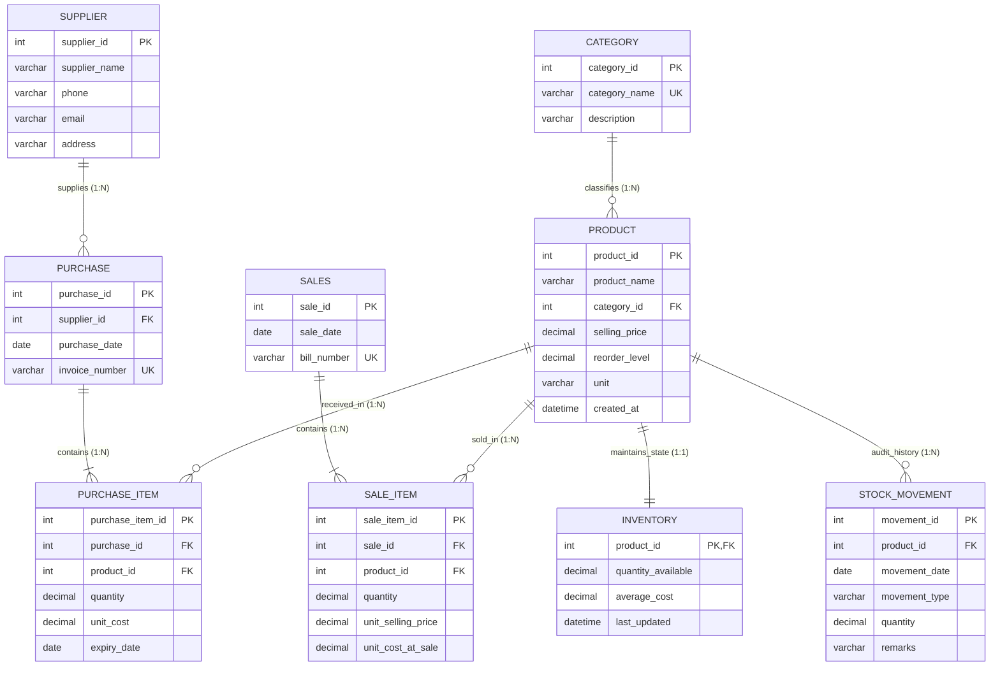
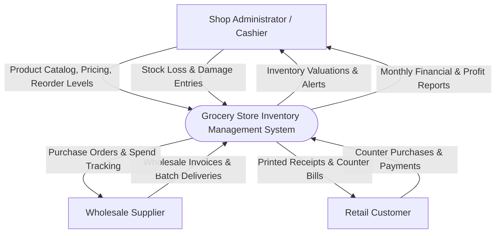
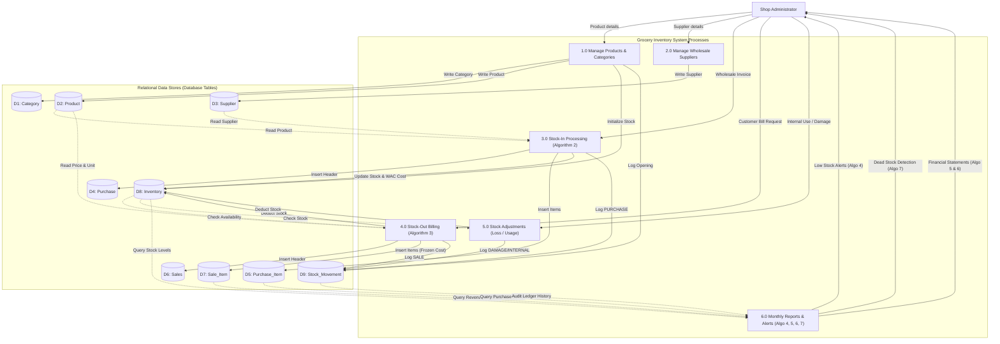
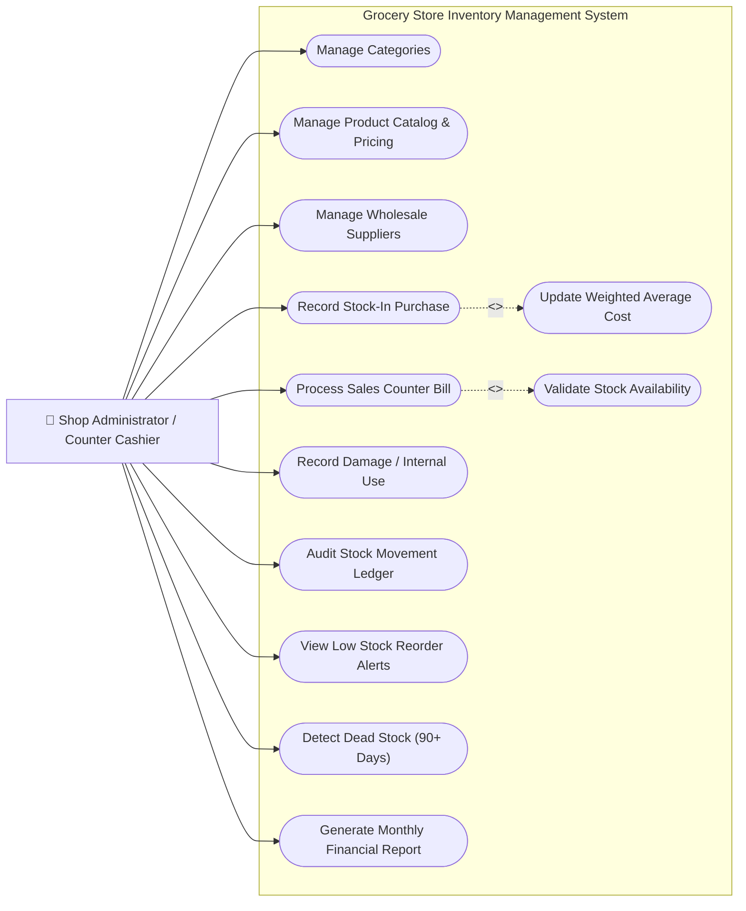
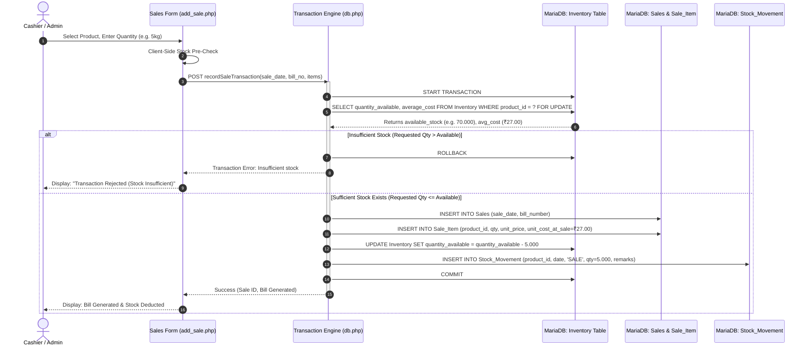
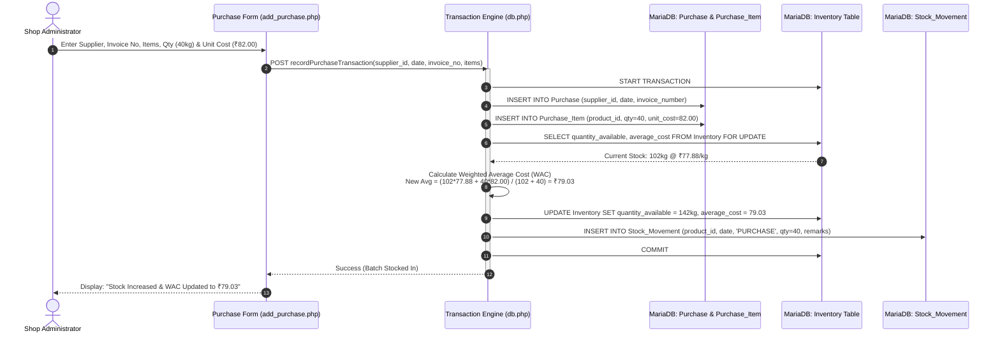
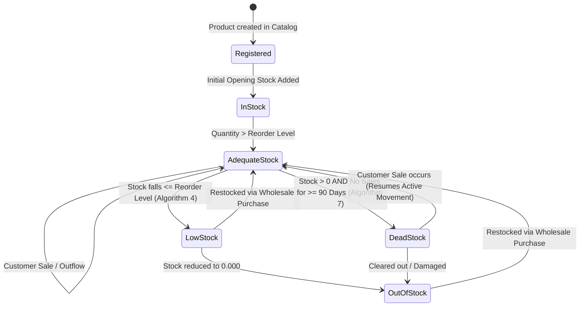

# GROCERY STORE INVENTORY MANAGEMENT SYSTEM
## COMPREHENSIVE SYSTEM & DATABASE ARCHITECTURE DIAGRAMS (PHASE 12)

This document contains the complete visual and technical diagrams for academic submission, project documentation, and viva voce presentation.

---

## 1. ENTITY-RELATIONSHIP (ER) DIAGRAM

The ER Diagram below depicts all **nine core entities**, attributes, primary keys (`PK`), foreign keys (`FK`), unique keys (`UK`), and Crow's Foot cardinalities.



### Cardinality Summary
- **Category to Product (1 : N):** One category classifies zero or many products; every product belongs to exactly one category.
- **Supplier to Purchase (1 : N):** One supplier provides zero or many purchase invoices; each purchase is sourced from one supplier.
- **Purchase to Purchase_Item (1 : N):** One purchase order contains one or many line items; each line item belongs to one invoice.
- **Product to Purchase_Item (1 : N):** One product appears across zero or many purchase line items.
- **Sales to Sale_Item (1 : N):** One counter bill contains one or many line items; each line item belongs to one sales bill.
- **Product to Sale_Item (1 : N):** One product is sold across zero or many customer bills.
- **Product to Inventory (1 : 1):** Every product has exactly one physical inventory balance record (`product_id` is both PK and FK).
- **Product to Stock_Movement (1 : N):** Every product maintains a continuous chronological audit ledger of all stock additions and deductions.

---

## 2. DATA FLOW DIAGRAMS (DFD)

### A. DFD Level 0 (Context Diagram)
Depicts the entire application as a single central process interacting with external entities.



---

### B. DFD Level 1 (Detailed Functional Process Decomposition)
Breaks down the system into core database-driven processes and shows interactions with the persistent Data Stores ($D_1$ to $D_9$).



---

## 3. USE CASE DIAGRAM

Illustrates the actor (Shop Administrator / Counter Cashier) and all primary business operations provided by the system.



---

## 4. SEQUENCE DIAGRAMS

### Sequence Diagram 1: Counter Sales Billing (Algorithm 3 - Stock-Out Transaction)
Demonstrates the atomic sequence of events when a cashier rings up an item, stock is validated, historical costs are frozen, and inventory is reduced.



---

### Sequence Diagram 2: Wholesale Purchase & Stock-In (Algorithm 2 - Weighted Average Costing)
Demonstrates how receiving wholesale inventory from suppliers increases physical stock and recalculates the Weighted Average Cost (WAC).



---

## 5. PRODUCT & INVENTORY STATE TRANSITION DIAGRAM

Illustrates the lifecycle states of a grocery item from initial registration through stock changes, low stock reorders, out-of-stock conditions, and stagnant dead-stock detection.



---

## 6. RELATIONAL SCHEMA ARCHITECTURE MAPPING

A structural table-by-table reference showing primary and foreign key relational mapping:

```
[Category]
  └── (category_id) ◄───┐
                        │ FK: fk_product_category (ON DELETE RESTRICT, ON UPDATE CASCADE)
[Product] ──────────────┴──────┬──────────────────┬─────────────────┐
  ├── (product_id) ◄─────────┐ │                  │                 │
  │                          │ │ FK               │ FK              │ FK
  │                          │ ▼                  ▼                 ▼
[Inventory] (1:1)       [Purchase_Item]       [Sale_Item]     [Stock_Movement]
  └── (product_id)           │                    │                 │
                             │ FK                 │ FK              │
                             ▼                    ▼                 │
                        [Purchase]              [Sales]             │
                             │                                      │
                             │ FK: fk_purchase_supplier             │
                             ▼                                      │
                        [Supplier]                                  │
```

